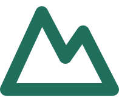
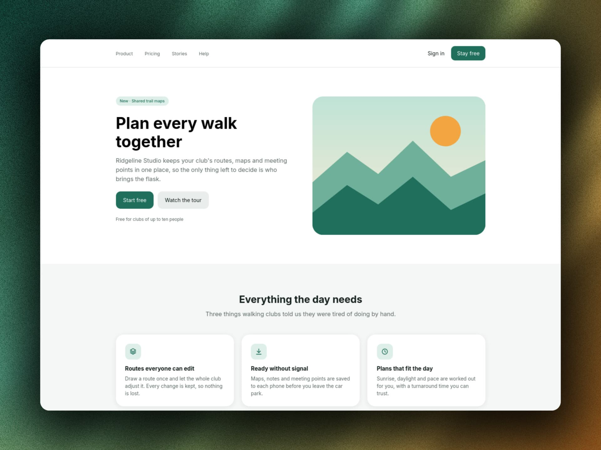

<header>
  <h3 align="center">
    
    <br>
    Ridgeline Studio 🏔️🥾
    
  </h3>

  <p align="center">
    <a href="https://github.com/NikolaM-Dev/learning-astro/blob/main/LICENSE"></a>
    <a href="https://github.com/NikolaM-Dev/learning-astro/contributors"></a>
    <a href="https://github.com/NikolaM-Dev/learning-astro/stargazers"></a>
    <a href="https://github.com/NikolaM-Dev/learning-astro/issues"></a>
    <a href="https://github.com/NikolaM-Dev/learning-astro/commits/main/"></a>
  </p>

  <div align="center">
    <figure>
      <a href="https://ridgeline-studio-eight.vercel.app">
        
      </a>
      <br>
      <figcaption><i>Ridgeline Studio Preview</i></figcaption>
    </figure>
  </div>
</header>

&nbsp;

<details><summary>👉 Table of Contents</summary>

- [📍 Overview](#-overview)
- [✨ Features](#-features)
- [⛅ Behind The Code](#-behind-the-code)
  - [🌈 Inspiration](#-inspiration)
  - [💡 Challenges / Learnings](#-challenges--learnings)
- [⚡ Quick Start](#-quick-start)
  - [🏕️ Run Locally](#️-run-locally)
- [🫂 Acknowledgments](#-acknowledgments)

</details>

## 📍 Overview

> Plan every walk together

Ridgeline Studio is a landing page for walking clubs, built with Astro inside
the learning-astro monorepo. It keeps a club's routes, maps and meeting points
in one place, so the only thing left to decide is who brings the flask. Maps,
notes and meeting points are saved to each phone before leaving, with sunrise,
daylight and pace worked out for the day.

## ✨ Features

- **Routes everyone can edit** draw a route once and let the whole club adjust
  it, with every change kept so nothing is lost
- **Ready without signal** maps, notes and meeting points are saved to each
  phone before leaving the car park
- **Plans that fit the day** sunrise, daylight and pace worked out for you, with
  a turnaround time you can trust
- **Responsive landing page** mobile and desktop hero art, accessible navigation
  with a menu toggle, plus stats, quotes and call-to-action sections

## ⛅ Behind The Code

### 🌈 Inspiration

Ridgeline Studio started as a practice project inside the learning-astro
monorepo, where each folder is one small project for learning Astro. It grew
from the Astro basics starter into a full walking-club landing page shaped by
iterative accessibility and responsive-layout work.

### 💡 Challenges / Learnings

- **Accessibility takes iteration** raising stat contrast, adding button names
  and fixing landmark structure to meet WCAG 2.2 AA
- **Small navigation details matter** repairing the mobile menu toggle and
  switching to semantic nav links
- **Shared building blocks pay off** unifying buttons with cva and a single
  `@/*` import alias across components
- **Checks catch drift early** running Astro check, tsrs typecheck and knip as
  part of the build and check scripts

## ⚡ Quick Start

### 🏕️ Run Locally

```bash
git clone https://github.com/NikolaM-Dev/learning-astro.git
cd learning-astro
cd ridgeline-studio
pnpm install
pnpm dev
```

## 🫂 Acknowledgments

- **Accessibility:**
  - [a11y DevTools](https://chromewebstore.google.com/detail/a11y-devtools/idikmoknbihljafgbjbbngnfogbnbjkb)
    for help me catch accessibility issues.
  - [axe DevTools](https://chromewebstore.google.com/detail/axe-devtools-web-accessib/lhdoppojpmngadmnindnejefpokejbdd)
    for help me catch accessibility issues and improve the semantics.
  - [ViewGrid Devtool](https://chromewebstore.google.com/detail/viewgrid-%E2%80%94-responsive-vie/hmlhooeamfmhdeichnghcklahfgimgef)
    for helping me to easily test several devices appying responsive design.
  - [Color Contrast Checker](https://color.adobe.com/create/color-contrast-analyzer)
    for help me improve the color contrasts following WCAG 2.2 AA.
- **Tools:**
  - [FigCraft](https://github.com/2KAbhishek/bare-minimum) for the landing page
    design and for be a free powerful Figma alternative.
  - [MockupViews](https://mockupviews.com/) for creating the stunning preview.
  - [Squoosh](https://squoosh.app/) for image optimization.
  - [catppuccin/catppuccin](https://github.com/catppuccin/catppuccin) for the
    README assets.

&nbsp;

<footer>
  <p align="center"></p>

  <p align="center">⭐ Hit the Star Button if You Found This Useful ⭐</p>
  <p align="center">
    <a href="https://x.com/nikolam_dev" target="_blank"></a>
    <a href="https://www.linkedin.com/in/nikolam-dev" target="_blank"></a>
    <a href="https://github.com/NikolaM-Dev" target="_blank"></a>
    <a href="#readme" target="_blank"></a>
  </p>
</footer>